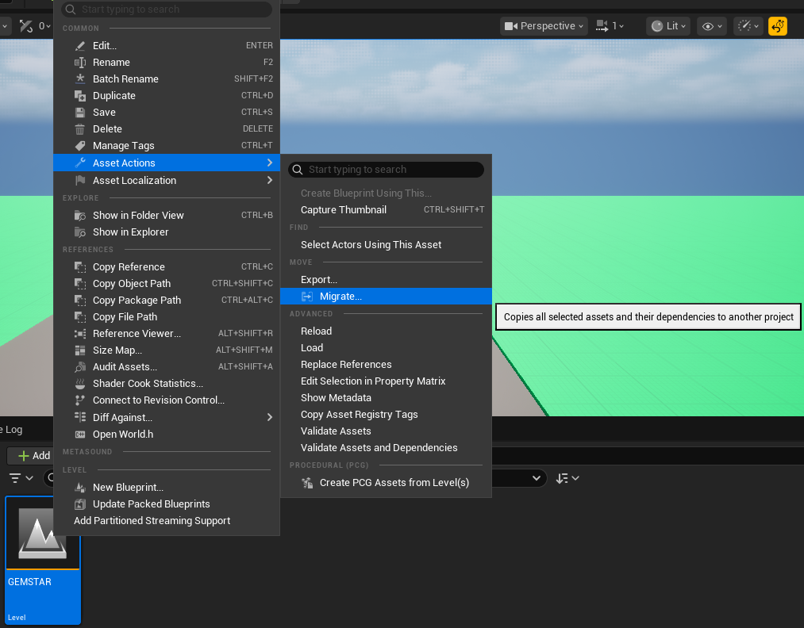
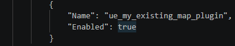
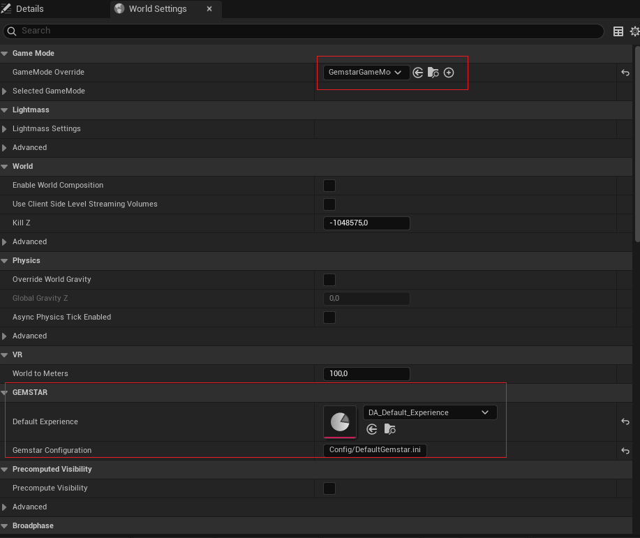
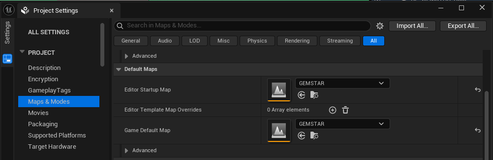

# Add a map

## Import map to GEMSTAR

### From an other project

Open the other project and migrate your map with all dependencies to the Content directory of GEMSTAR.



### From an other Unreal Engine plugin

Add the plugin to GEMSTAR.
Use git submodule to track your changes.

```
cd Plugins
git submodule add <your plugin with map>
```

Enable your Plugin through the Unreal Editor or directly in the `GEMSTAR.uproject` file.



⚠️ If running Visual Studio to launch Unreal Engine regenerate the solution files by `PostGitPull_ReGenVSFiles.bat`

## Add GEMSTARGameMode

Open your map in
`World Setting`, select `GEMSTARGameMode` and specify the GEMSTAR configuration file used for this level.
Optionally, you can set the GEMSTAR experience to be activated when the level starts.



## Change maps for editor startup and game

Change inside the project settings the Maps & Modes to load your map as the Editor Startup Map and Game Default Map.


