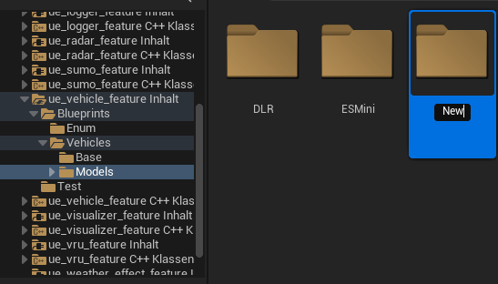
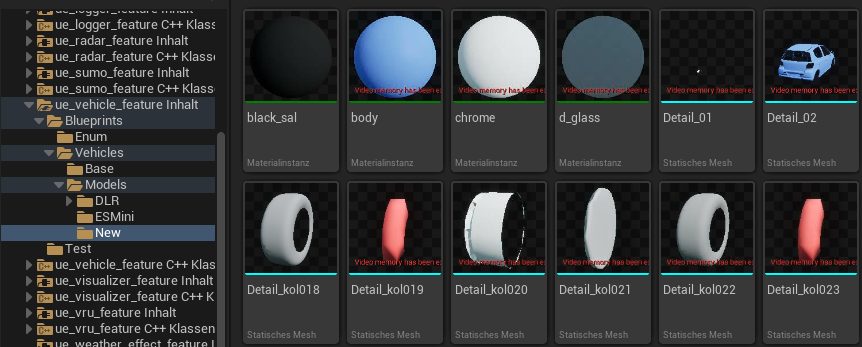
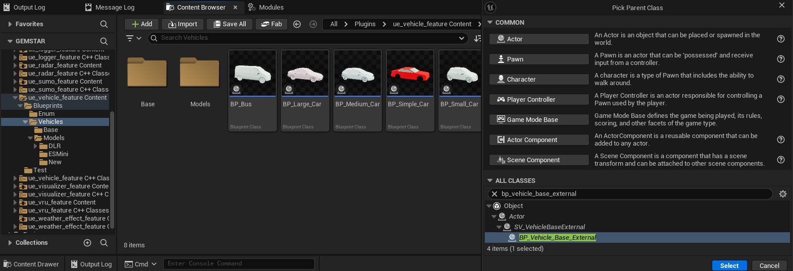
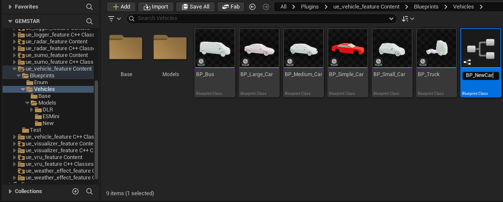
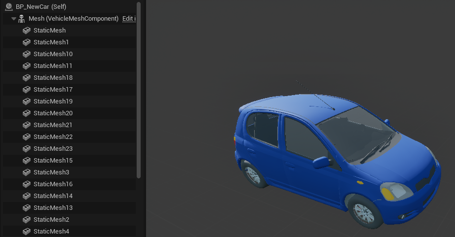
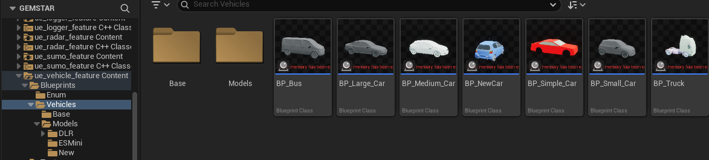
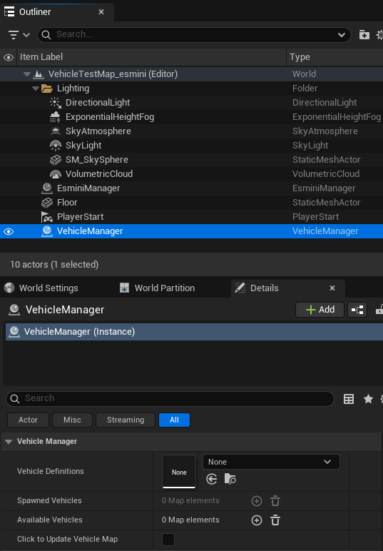
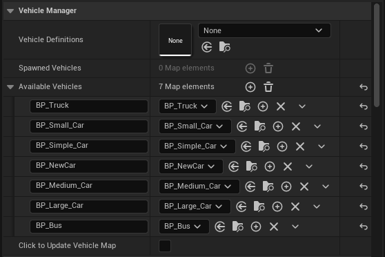
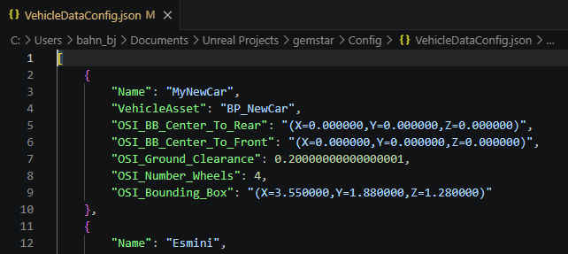

# Add a vehicle

Follow this guide to add a new vehicle to `ue_vehicle_feature` in GEMSTAR.
Adding new VRU models is the same process just in the `ue_vru_feature`.

Create a new directory in `ue_vehicle_feature/Blueprints/Vehicles/Models`

Import your model into Unreal by right click and import, e.g. from an .fbx file.\
The directory should contain the new file. Save them with Ctrl+Shift+s.

Create a new Bluepint in `ue_vehicle_feature/Blueprints/Vehicles` with BP_Vehicle_Base_External as a parent class.

Name the Blueprint accordingly to the model: `BP_<model>`

" width="800"/>

Open the Blueprint and add your model as StaticMeshes and/or Mesh (depends on your model).\
This example vehicle consists only of 24 static meshes.

⚠️Check that your model is facing in positive X direction. If your Content Brower preview thumbnail looks like the following image the rotation is not correct!

" width="500"/>

Open a map with a VehicleManager present in the map, e.g. the test maps in `ue_vehicle_feature`.
Open the details tab and click on the "Click to Update Vehicle Map" checkbox.
This triggers the import function to check if your new files are correctly detected.

Check the result by opening the "Available Vehicles" map.
The BP_NewCar is correctly detected and will now be detected automatically.
You do not have to save the changes in the map.

To fill the gap between the vehicle name in the scenario and the model, add an entry to `Simulation/Vehicle/VehicleDataConfig.json` (or the VehicleDataConfiguration file defined in the `Simulation/DefaultGemstar.ini`)

The entries Name, VehicleAsset and OSI_Bounding_Box will be used for matching the scenario vehicle name and type to the available models.
Check the matching priorities for [Scenario with Sumo](SUMOScenario.md#matching-priority) and [Scenario with Esmini](EsminiScenario.md#matching-priority).\
The other values are part of the [VehicleAttributes](https://www.asam.net/static_downloads/ASAM_OSI_reference-documentation_v3.5.0/structosi3_1_1MovingObject_1_1VehicleAttributes.html) from Open Simulation Interface.
