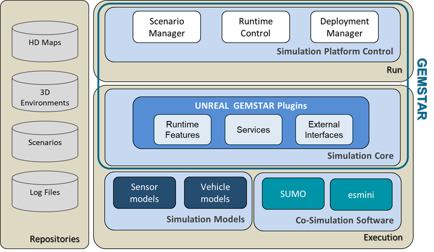
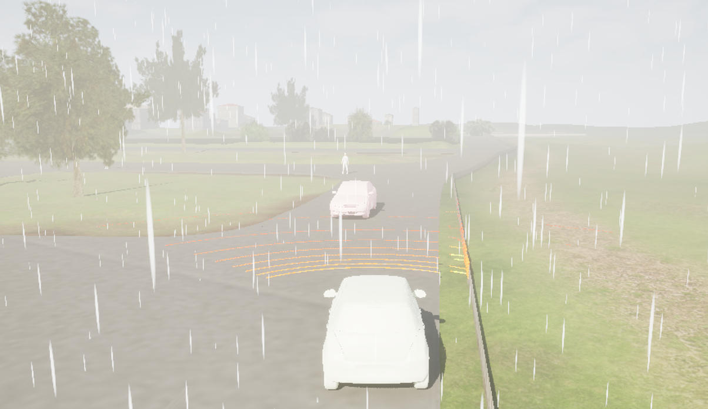

# GEMSTAR (GEoMetry based Sensor simulation Toolchain for Automotive and Rail research)

GEMSTAR is the GEoMetry based Sensor simulation Toolchain for Automotive and Rail research.\
The simulation tool supports the descision process for approval of operation domain (OD) and Operational Design Domain (ODD) for automated vehicles.

The simulation software GEMSTAR is a set of [Unreal Engine 5.8](https://www.unrealengine.com/en-US/unreal-engine-5) Plugins.
Each plugin can be used standalone in Unreal to maximise flexibility.
GEMSTAR combines exisiting simulation tools in a co-simulation and uses [OSI](https://www.asam.net/standards/detail/osi/) standardized messages for logging and communication.
It is designed to be tailored to your project specific needs by integration of [SUMO](https://eclipse.dev/sumo/), [esmini](https://esmini.github.io/) and more by using the [Game Feature Plugin](https://dev.epicgames.com/documentation/en-us/unreal-engine/game-features-and-modular-gameplay-in-unreal-engine) system.
Future updates will add new features: OSI Playback, OpenDrive map import, Traffic Lights, Radar, Interfaces to [ROS2](https://ros.org/) and [OSMP](https://www.asam.net/standards/detail/osi/).

# Use Cases

- Evaluating vehicle and route compatibility.
- Selecting the optimal infrastructure for automated vehicles.
- Testing planned sensor configurations.

# Getting started

GEMSTAR is an Unreal project.
It builds on the Unreal Engine Game Features where each feature is located in a seperate plugin.
Build and run it on Windows and Linux.
Your hardware should be a decent x86 computer.

- [Windows Quickstart](Documentation/QuickstartWindows.md)
- [Linux Quickstart](Documentation/QuickstartLinux.md)
- [Docker Quickstart](Documentation/QuickstartDocker.md)

## Demo map

The demo map is `Content/GEMSTAR.umap`.
Its scenario is configured in `Simulation/DefaultGemstar.ini` and generated during the first build.

- `esmini` supplies vehicle input.
- The ego vehicle uses a camera, lidar and radar.
- The lidar SensorView is supplied to the FMI lidar detection model.
- The visualizer consumes these three sensor streams.
- The OSI logs for GroundTruth, SensorView and SensorData are saved in the `Output` directory.

Each GEMSTAR feature plugin shows their functionality in a specific feature test map in their plugin content directory.

# Bring your own content

Customize your simulation by changing the scenario, maps and sensor models.
GEMSTAR is configured by using a ini file e.g. `Simulation/DefaultGemstar.ini` file.
A combined example map is located in the Content directory.
It shows the integration of the different plugins.

## Scenarios and Maps

Run your own scenarios with:
- [OpenSCENARIO with esmini Quickstart](Documentation/EsminiScenario.md)
- [Eclipse SUMO Quickstart](Documentation/SUMOScenario.md)

Import Unreal Engine map to GEMSTAR.
The 3D world is used for sensors.

- [Add unreal maps](Documentation/AddMap.md)

## Vehicles and VRUs

Add vehicle or VRU models to your scenario in `ue_vehicle_feature` and `ue_vru_feature`
- [Add a vehicle](Documentation/AddVehicle.md)

## FMI Sensor models

Add perceptions sensor models to `ue_fmi_feature` e.g. from [ENVITED Open Source Model & Simulation Library](https://github.com/openMSL)

## Third party content
Recompile [third party binaries](Documentation/ThirdPartyLibraries.md) if needed.

## Bulk Mode
Run multiple scenarios one by one, see [Bulk Mode](Documentation/BulkMode.md)
---------------
**Contact:** opensource-ts@dlr.de

# License

This project is published under the Eclipse Public License 2.0.

This project uses the Open Simulation Interface ([OSI](https://github.com/OpenSimulationInterface/open-simulation-interface)), which is licensed under the Mozilla Public License 2.0.\
This project uses [esmini](https://github.com/esmini/esmini), which is licensed under the Mozilla Public License 2.0.\
This project uses [Eclipse SUMO](https://github.com/eclipse-sumo/sumo), which is licensed under the Eclipse Public License 2.0.
